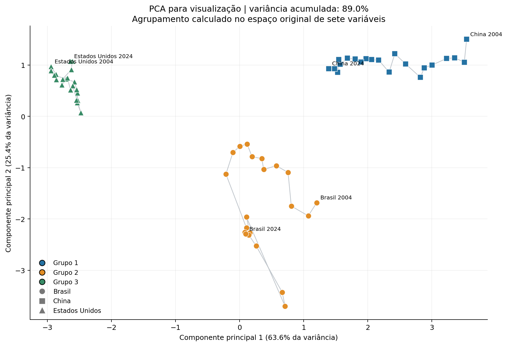

# Perfis econômicos de Brasil, China e Estados Unidos (2004–2024)

Projeto de Introdução à Ciência de Dados — **Opção B: Aprendizado não supervisionado**.

**Pergunta:** quais perfis de país-ano emergem ao combinar nível econômico, produtividade, composição do emprego e distribuição da renda no Brasil, na China e nos Estados Unidos entre 2004 e 2024?

O estudo usa 63 observações país-ano, nove indicadores públicos de Banco Mundial, ILOSTAT e WID e sete atributos após transformação. País e ano servem apenas para integrar e interpretar os dados; não entram na distância dos modelos. Não há variável-alvo nem rótulos de referência.

## Resultado principal

Foram comparadas **34 configurações** de KMeans, agrupamento hierárquico Ward e DBSCAN. A regra definida antes da comparação selecionou **KMeans (k=3)**: silhouette **0,668**, Davies–Bouldin **0,581** e cobertura de **100%**. A referência KMeans com k=2 apresentou silhouette 0,544.

**O resultado separou os países:** todos os 21 anos da China ficaram no grupo 1, todos os 21 do Brasil no grupo 2 e todos os 21 dos Estados Unidos no grupo 3. As diferenças persistentes entre países dominaram as mudanças ao longo dos anos; não foram encontrados regimes temporais distintos na partição escolhida. KMeans, Ward e a melhor parametrização elegível de DBSCAN chegaram à mesma partição, sem evidência de superioridade substantiva de uma dessas três soluções.

| Técnica | Melhor partição elegível | Silhouette ↑ | Davies–Bouldin ↓ | Calinski–Harabasz ↑ | Menor grupo |
|---|---|---|---|---|---|
| KMeans | KMeans (k=3) | 0,668 | 0,581 | 146,4 | 21 |
| Ward | Ward (k=3) | 0,668 | 0,581 | 146,4 | 21 |
| DBSCAN | DBSCAN (eps=2,00, min_samples=3) | 0,668 | 0,581 | 146,4 | 21 |

Na robustez temporal, a técnica selecionada teve ARI médio 1,000 e mínimo 1,000 nos 18 blocos válidos. Os grupos descrevem esta amostra; não constituem ranking de países nem evidência causal. As observações de um mesmo país ao longo do tempo são dependentes.



A projeção PCA é apenas visual: os agrupamentos usam os sete atributos. Os dois componentes exibem 89,0% da variância.

## Como reproduzir

Recomendado: **Python 3.12**. Na raiz deste projeto, crie um ambiente isolado, instale as versões de `requirements.txt` e execute:

```powershell
py -3.12 -m venv .venv
.venv\Scripts\python -m pip install -r requirements.txt
.venv\Scripts\python src/prepare_data.py
.venv\Scripts\python src/analysis.py
.venv\Scripts\python src/export_report.py
```

Em Linux/macOS, substitua `py -3.12` por `python3.12` e `.venv\Scripts\python` por `.venv/bin/python`. A primeira instalação requer internet; a análise usa as tabelas congeladas incluídas no repositório e pode rodar offline. Os comandos recriam o painel validado, as tabelas de resultados e as seis figuras. A execução não altera os arquivos originais fornecidos para o trabalho.

Para explorar de forma interativa, abra `projeto_nao_supervisionado.ipynb` no Jupyter ou no VS Code e execute as células em ordem com o mesmo ambiente. Se precisar de uma interface Jupyter, instale-a com `.venv\Scripts\python -m pip install jupyterlab` e abra com `.venv\Scripts\python -m jupyterlab`. O notebook inclui explicações e resultados; os scripts concentram o pipeline reproduzível.

## Arquivos principais

| Arquivo/pasta | Conteúdo |
|---|---|
| `projeto_nao_supervisionado.ipynb` | Notebook com execução e interpretação |
| `src/prepare_data.py` | Integração, integridade e validação das fontes |
| `src/analysis.py` | EDA, transformações, modelos, busca e robustez |
| `data/raw/` | Recorte público congelado, metadados e manifesto SHA-256 |
| `data/processed/` | Painel com grupos, atributos transformados e perfis |
| `results/` | Comparação de 34 configurações, testes e resumo JSON |
| `figures/` | Seis figuras do estudo |
| [Dicionário e proveniência](data/README.md) | Definições, unidades, códigos e recorte |
| [Relatório completo](docs/relatorio.md) | Problema, método, resultados e limitações |
| [Relatório em PDF](docs/relatorio.pdf) | Versão pronta para leitura e apresentação |
| `src/export_report.py` | Recriação do relatório PDF a partir dos resultados |
| [Roteiro do vídeo](docs/roteiro_video.md) | Sugestão para a gravação da apresentação |

## Decisões metodológicas

- Logaritmo natural no PIB per capita e na produtividade; transformação ILR em cada composição de três partes (emprego e renda); StandardScaler nos sete atributos.
- KMeans e Ward com k de 2 a 6; DBSCAN com oito valores de eps e três valores de min_samples.
- Seleção entre partições com cobertura de 100%, 2 a 6 grupos e ao menos quatro observações por grupo: maior silhouette e, no desempate, menor Davies–Bouldin.
- Robustez por 18 exclusões de blocos de quatro anos comuns aos três países, reajustando todo o pré-processamento; 20 sementes para KMeans; quatro alterações de atributos/escala.
- Não se usa acurácia, F1 ou divisão aleatória treino/teste: não há rótulos verdadeiros nem objetivo de previsão. O ARI compara partições para medir estabilidade.

## Fontes e limites

O PIB per capita está em US$ constantes de 2015; a produtividade está em PPC de 2021. São conceitos e unidades diferentes. As participações de renda WID são antes de impostos, para adultos com recursos divididos igualmente dentro do casal. A OIT inclui estimativas modeladas; flags e códigos originais foram preservados e não tratados como garantia de observação direta.

- Banco Mundial: [PIB per capita em US$ constantes de 2015 — NY.GDP.PCAP.KD](https://data.worldbank.org/indicator/NY.GDP.PCAP.KD).
- Banco Mundial/ILOSTAT: [emprego na agropecuária — SL.AGR.EMPL.ZS](https://data.worldbank.org/indicator/SL.AGR.EMPL.ZS), [indústria — SL.IND.EMPL.ZS](https://data.worldbank.org/indicator/SL.IND.EMPL.ZS) e [serviços — SL.SRV.EMPL.ZS](https://data.worldbank.org/indicator/SL.SRV.EMPL.ZS).
- OIT/ILOSTAT: [portal de dados](https://ilostat.ilo.org/data/) e [orientações sobre estimativas modeladas e comparações entre países](https://www.ilo.org/resource/news/note-ilo-modelled-estimates-and-country-rankings-or-comparisons).
- World Inequality Database: [metodologia e recursos DINA](https://wid.world/methodology/). As definições específicas da variável `sptincj992` e as referências de cada país estão preservadas em `data/raw/wid_metadata.csv`.
- scikit-learn: [agrupamento e avaliação](https://scikit-learn.org/stable/modules/clustering.html), [KMeans](https://scikit-learn.org/stable/modules/generated/sklearn.cluster.KMeans.html), [Ward](https://scikit-learn.org/stable/modules/generated/sklearn.cluster.AgglomerativeClustering.html), [DBSCAN](https://scikit-learn.org/stable/modules/generated/sklearn.cluster.DBSCAN.html), [StandardScaler](https://scikit-learn.org/stable/modules/generated/sklearn.preprocessing.StandardScaler.html) e [PCA](https://scikit-learn.org/stable/modules/generated/sklearn.decomposition.PCA.html).


Fontes e documentação consultadas em 20/10/2026. Os resultados usam a fotografia local identificada pelo manifesto; não foi feita atualização dos valores via internet.

## Entrega no Google Classroom

Anexe os dois links solicitados: **o endereço deste repositório público no GitHub** e **o link do vídeo que será gravado pelo autor**. Antes de enviar, confirme que ambos podem ser abertos pelo professor. O repositório precisa conter os arquivos deste projeto na raiz, não apenas o arquivo ZIP.
