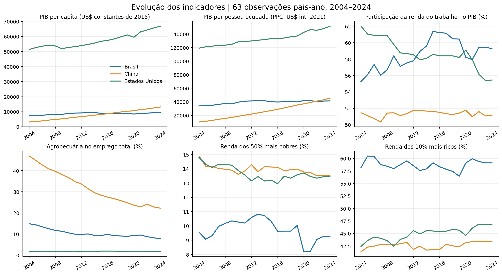
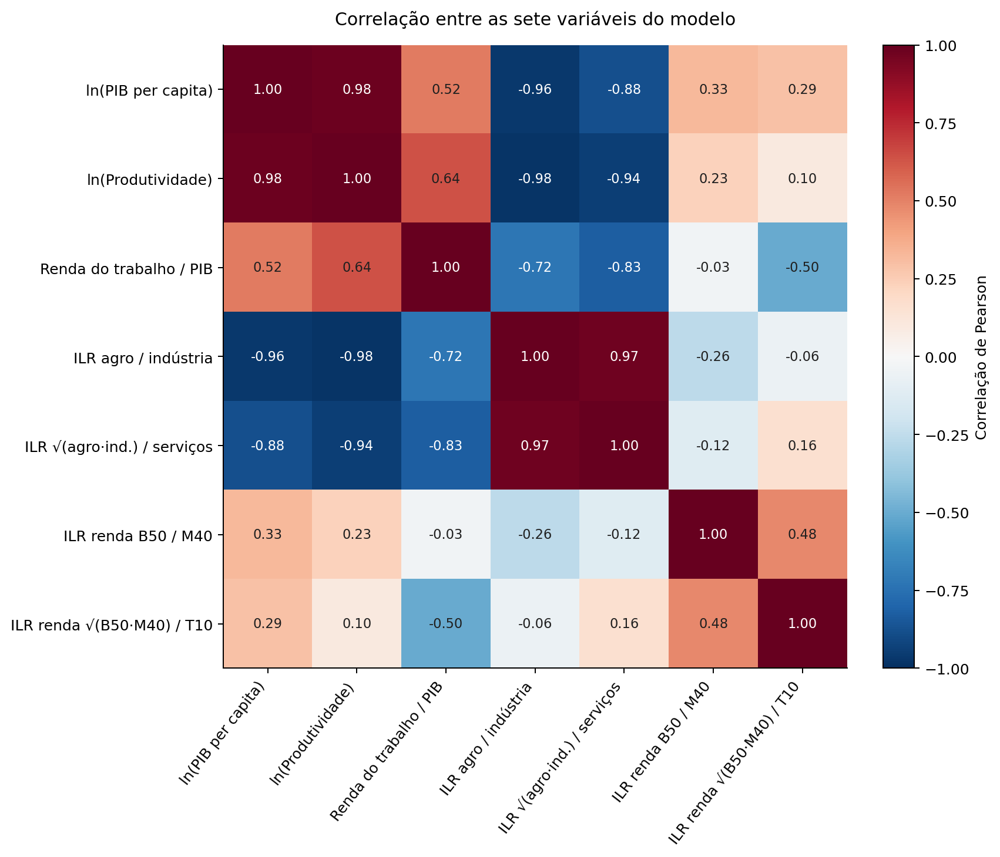
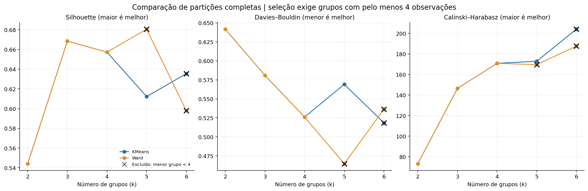
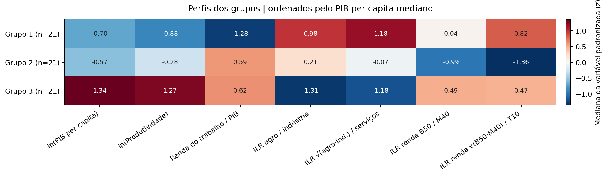
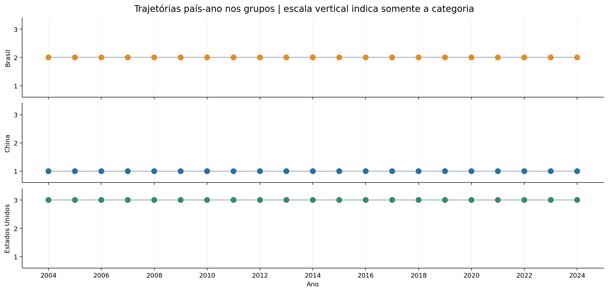

# Agrupamento de perfis econômicos de Brasil, China e Estados Unidos

**Disciplina:** Introdução à Ciência de Dados · **Abordagem escolhida:** Opção B — Aprendizado não supervisionado · **Período:** 2004–2024 · **Unidade:** país-ano.

## Resumo

Este projeto investigou como indicadores econômicos, de trabalho e de distribuição da renda organizam as trajetórias de Brasil, China e Estados Unidos em perfis semelhantes. Integraram-se fontes públicas do Banco Mundial, ILOSTAT e WID em um painel completo de 63 país-anos e nove indicadores. O tratamento produziu sete atributos, com logaritmos, coordenadas ILR para dados de composição e padronização. Compararam-se 34 configurações de KMeans, agrupamento hierárquico Ward e DBSCAN. A regra de seleção favoreceu KMeans (k=3), com silhouette 0,668 e cobertura integral. A estabilidade foi avaliada retirando blocos temporais e reajustando o pipeline, além de variar sementes, atributos e escalonamento. As conclusões descrevem a geometria deste painel e permanecem condicionadas à escolha dos países, dos indicadores e das fontes.

O principal resultado foi a separação por país: cada grupo reuniu os 21 anos de uma economia. Portanto, neste espaço de atributos, diferenças persistentes entre os países dominaram as mudanças temporais. O modelo não identificou regimes compartilhados entre países ou transições temporais na partição selecionada.

## 1. Problema e justificativa

**Pergunta de pesquisa:** quais perfis de país-ano emergem ao combinar nível econômico, produtividade, composição do emprego e distribuição da renda no Brasil, na China e nos Estados Unidos entre 2004 e 2024?

O objetivo é identificar semelhanças e mudanças de perfil, sem prever um resultado conhecido. A mesma unidade nacional pode aparecer em grupos diferentes ao longo do período. A aplicação é exploratória: organizar evidências para selecionar comparações e hipóteses futuras, como investigar se uma mudança de composição do emprego acompanha uma mudança de perfil distributivo. O agrupamento não testa relações de causa e efeito.

A opção B é adequada porque não existe variável-alvo no problema definido. `country` e `year` identificam os registros e permitem a leitura posterior das trajetórias. Nenhum dos dois é usado como atributo, rótulo verdadeiro ou critério de escolha do número de grupos.

## 2. Dados, proveniência e integração

O painel contém 21 anos para cada um dos três países, totalizando **63 observações**, sem linhas duplicadas ou valores faltantes nos nove indicadores selecionados. O recorte usa os arquivos públicos já fornecidos com o projeto. Os arquivos ILO originais carregam a data 19/09/2026 no nome; o recorte local foi extraído em 20/10/2026. A execução comum não baixa revisões posteriores.

| Coluna no painel | Definição e unidade | Fonte/código |
|---|---|---|
| `country`, `year` | Código ISO3 e ano; identificadores, excluídos dos atributos do modelo | Chave da integração |
| `gdp_per_capita` | PIB per capita em **US$ constantes de 2015**; não é uma medida em PPC | Banco Mundial, `NY.GDP.PCAP.KD` |
| `productivity` | PIB por pessoa ocupada em dólares internacionais constantes de 2021, PPC | ILOSTAT, `GDP_211P_NOC_NB` |
| `labor_share` | Participação da renda do trabalho no PIB, em % | ILOSTAT, `SDG_1041_NOC_RT` |
| `agriculture` | Emprego na agropecuária como % do emprego total | Banco Mundial/ILOSTAT, `SL.AGR.EMPL.ZS` |
| `industry` | Emprego na indústria como % do emprego total | Banco Mundial/ILOSTAT, `SL.IND.EMPL.ZS` |
| `services` | Emprego nos serviços como % do emprego total | Banco Mundial/ILOSTAT, `SL.SRV.EMPL.ZS` |
| `income_bottom50` | Participação dos 50% inferiores na renda nacional antes de impostos, em % | WID, `sptincj992`, `p0p50` |
| `income_middle40` | Participação dos 40% intermediários na mesma renda, em % | WID, `sptincj992`, `p50p90` |
| `income_top10` | Participação dos 10% superiores na mesma renda, em % | WID, `sptincj992`, `p90p100` |

Os nove indicadores combinam três dimensões: nível econômico/produtividade, estrutura do trabalho e distribuição da renda. Para renda, a WID define a população como adultos acima de 20 anos e divide os recursos igualmente entre os adultos de um casal. A renda nacional é medida antes de impostos, conforme a definição de renda pré-tributação da WID, que também especifica o tratamento das pensões. As frações originais foram multiplicadas por 100 para formar porcentagens.

As participações setoriais representam **emprego**, não valor adicionado. O PIB per capita está em **US$ constantes de 2015**, enquanto o PIB por pessoa ocupada está em **dólares internacionais constantes de 2021 em PPC**. Os valores monetários não são diretamente equivalentes e não são somados ou divididos entre si no estudo.

A extração filtra país, período, indicador e percentil; verifica a unicidade das chaves; integra as tabelas por país-ano; e confirma o painel de 63 × 9. `data/raw/manifest.json` preserva nomes, tamanho e hashes SHA-256 dos arquivos de origem, além dos hashes das pequenas tabelas distribuídas. Os metadados de PIB e WID e os códigos/flags do ILOSTAT acompanham o recorte. Essa documentação permite rastrear definições e revisões sem publicar os arquivos originais completos.

Na tabela ILOSTAT extraída, `obs_status` de `labor_share` aparece vazio em 18 registros, como `I` em 42 e como `M` em 3. Os códigos são mantidos sem atribuir significados não confirmados no dicionário da edição original. Os indicadores setoriais são identificados pela fonte como estimativas modeladas da OIT. A ausência de uma flag não é prova de observação direta. A [orientação oficial da OIT](https://www.ilo.org/resource/news/note-ilo-modelled-estimates-and-country-rankings-or-comparisons) alerta para incerteza e para o uso inadequado de observações imputadas em rankings/comparações. Por isso, os grupos são tratados como descrições exploratórias, sem ranking ou afirmação de superioridade nacional.

## 3. Análise exploratória e qualidade

O diagnóstico verifica tipos numéricos, finitude, positividade, duplicatas e intervalos coerentes de porcentagens. As duas composições precisam conter partes positivas e somar aproximadamente 100%. O processo interrompe a execução se a fotografia não satisfizer os contratos esperados, evitando corrigir silenciosamente inconsistências de integração. Não houve necessidade de remover linhas ou preencher valores faltantes no recorte.

As diferenças de escala justificam a padronização antes de calcular distâncias. PIB e produtividade são positivos e variam em escala monetária; suas transformações logarítmicas representam diferenças relativas. As participações setoriais e distributivas são dados de composição: uma parte depende das demais porque o total é fixo. Incluí-las diretamente em três porcentagens por composição introduziria redundância.

| País | PIB/hab. US$2015: 2004 → 2024 | Emprego agro %: 2004 → 2024 | Renda dos 10% %: 2004 → 2024 |
|---|---|---|---|
| Brasil | 7.259 → 9.567 | 14,8 → 7,7 | 58,2 → 59,1 |
| China | 3.128 → 13.119 | 46,9 → 22,2 | 41,3 → 43,5 |
| Estados Unidos | 51.348 → 66.857 | 1,9 → 1,6 | 42,4 → 46,8 |

As variações acima são leituras descritivas entre os extremos do período. As séries completas estão na Figura 1 e em `data/raw/painel_fontes.csv`; elas não isolam efeitos de políticas, crises ou estrutura demográfica.

A matriz de correlação é calculada sobre os sete atributos efetivamente fornecidos aos modelos. Correlações elevadas indicam que dimensões econômicas podem receber peso implícito maior, mesmo após padronização; por isso o estudo inclui uma variante sem PIB e produtividade. Correlação e associação visual não estabelecem causalidade.

As estatísticas descritivas completas, incluindo quartis e extremos, estão em `results/estatisticas_descritivas.csv`; a correlação numérica está em `results/correlacao_features.csv`.

## 4. Pré-processamento e espaço dos modelos

O pipeline utiliza uma imputação por mediana, aprendida somente no conjunto usado no ajuste; essa etapa é uma proteção de implementação e não alterou esta base completa. Em seguida aplica logaritmo natural ao PIB per capita e à produtividade. Cada composição de três partes positivas é fechada para soma unitária, corrigindo apenas arredondamentos. A transformação ILR utiliza duas coordenadas ortonormais:

`ILR1 = ln(x1/x2) / sqrt(2)`

`ILR2 = sqrt(2/3) × ln(sqrt(x1 × x2)/x3)`

Para emprego, a ordem é agropecuária, indústria e serviços. Para renda, a ordem é 50% inferiores, 40% intermediários e 10% superiores. Assim, nove indicadores originam **sete atributos**: dois logaritmos, a participação do trabalho, duas coordenadas de emprego e duas de renda. Não se codificam países nem anos como números ou variáveis binárias.

O StandardScaler centraliza cada atributo pela média e divide pelo desvio padrão. Isso evita que uma unidade monetária domine as distâncias por sua escala. Todas as técnicas são ajustadas no mesmo espaço de sete atributos, com distância euclidiana. Em cada teste por blocos, medianas e escala são reaprendidas apenas nas 51 observações remanescentes. A PCA é ajustada separadamente para desenhar a projeção de duas dimensões; ela não reduz a informação usada no agrupamento.

## 5. Técnicas, busca e seleção

Compararam-se três famílias para explorar pressupostos diferentes: KMeans minimiza a dispersão em torno de centros; Ward constrói uma hierarquia por aumentos da dispersão interna; DBSCAN procura regiões de densidade e pode marcar pontos como ruído. A [documentação oficial do scikit-learn](https://scikit-learn.org/stable/modules/clustering.html) apresenta suas características e restrições.

| Técnica | Grade definida | Total |
|---|---|---:|
| KMeans | k = 2, 3, 4, 5, 6; `n_init=50`; semente 42 | 5 |
| Ward | k = 2, 3, 4, 5, 6; ligação `ward` | 5 |
| DBSCAN | eps = 0,35; 0,50; 0,65; 0,80; 1,00; 1,25; 1,50; 2,00; `min_samples` = 3, 4, 5 | 24 |
| **Total** | | **34** |

Para a partição principal, os critérios definidos são cobertura de 100%, de dois a seis grupos e ao menos quatro país-anos por grupo. Entre as configurações elegíveis, escolhe-se a maior silhouette; em caso de empate, o menor índice Davies–Bouldin. O mínimo de quatro evita que grupos muito pequenos sejam favorecidos pela busca, mas permanece uma decisão exploratória. Essa regra não identifica um número universalmente verdadeiro de grupos.

Silhouette sintetiza separação e coesão (maior é melhor, em geral entre −1 e 1); Davies–Bouldin penaliza a similaridade entre grupos (menor é melhor); Calinski–Harabasz compara dispersão entre e dentro dos grupos (maior é melhor). São métricas internas, sem verdade externa. A [documentação de avaliação de agrupamentos](https://scikit-learn.org/stable/modules/clustering.html#clustering-performance-evaluation) descreve seu uso. O ARI é reservado à estabilidade entre duas partições, não à acurácia contra países ou anos.

KMeans com k=2 funciona como referência simples da própria tarefa não supervisionada. Não se aplicam requisitos da opção supervisionada como F1, RMSE, variável-alvo ou teste aleatório para previsão. Para DBSCAN, relatam-se cobertura e quantidade de ruído; a silhouette do subconjunto agrupado não disputa diretamente a seleção principal quando há pontos excluídos.

## 6. Resultados da comparação

| Técnica | Melhor partição elegível | Silhouette ↑ | Davies–Bouldin ↓ | Calinski–Harabasz ↑ | Menor grupo |
|---|---|---|---|---|---|
| KMeans | KMeans (k=3) | 0,668 | 0,581 | 146,4 | 21 |
| Ward | Ward (k=3) | 0,668 | 0,581 | 146,4 | 21 |
| DBSCAN | DBSCAN (eps=2,00, min_samples=3) | 0,668 | 0,581 | 146,4 | 21 |

Das 34 configurações, 8 cumpriram os critérios de elegibilidade. O modelo selecionado foi **KMeans (k=3)**, com silhouette **0,668**, Davies–Bouldin **0,581**, Calinski–Harabasz **146,4** e menor grupo com **21** país-anos. A diferença de silhouette frente à referência KMeans k=2 foi **0,124**, uma diferença na própria amostra, sem interpretação de ganho preditivo.

As melhores configurações de KMeans, Ward e DBSCAN produziram a mesma partição completa e as mesmas métricas. A implementação manteve KMeans como representante no empate, pela ordem da grade. A escolha desse nome não demonstra vantagem empírica sobre as outras duas soluções equivalentes; a interpretação central é o acordo entre as três técnicas neste recorte.

Ward com k=5 apresentou silhouette 0,681, acima de 0,668, mas seu menor grupo continha apenas 2 observações. Essa configuração foi **inelegível** pelo mínimo de quatro definido para a análise principal. O exemplo mostra que a seleção combinou qualidade geométrica e uma restrição explícita de tamanho, em vez de simplesmente tomar a maior silhouette de toda a grade.

Entre as parametrizações exploratórias de DBSCAN com métricas definidas, DBSCAN (eps=0,35, min_samples=5) obteve silhouette 0,912, com cobertura de 30,2% e 44 observações de ruído. Essa silhouette usa apenas os pontos agrupados quando há ruído; por isso, ela deve ser lida junto da cobertura, sem comparação direta com partições completas.

A grade completa, incluindo parametrizações degeneradas e configurações com ruído, está em `results/grid_modelos.csv`. Uma célula de métrica vazia significa que a métrica não foi definida para a partição resultante, por exemplo quando há menos de dois grupos válidos. Não corresponde a zero desempenho.

## 7. Perfis e trajetórias

Os números de grupos são apenas categorias de leitura, reordenadas pelo PIB per capita mediano. A ordenação facilita a consistência dos gráficos e não é um índice de desenvolvimento ou qualidade de vida.

| Grupo | n | Países | PIB/hab. US$2015 | PIB/ocup. PPC2021 | Renda do trabalho % | Renda dos 10% % |
|---|---|---|---|---|---|---|
| 1 | 21 | CHN | 7.686 | 25.450 | 51,4 | 42,7 |
| 2 | 21 | BRA | 8.771 | 40.241 | 58,4 | 58,8 |
| 3 | 21 | USA | 55.665 | 131.690 | 58,5 | 45,4 |

As colunas monetárias usam unidades diferentes: US$2015 para PIB por habitante e PPC2021 para PIB por pessoa ocupada. Cada número é uma mediana descritiva das observações do grupo, sem ponderação por população ou tamanho da economia.

| País | Grupo 1 | Grupo 2 | Grupo 3 |
|---|---|---|---|
| Brasil | 0 | 21 | 0 |
| China | 21 | 0 | 0 |
| Estados Unidos | 0 | 0 | 21 |

Apesar de país não ter entrado no modelo, a partição coincide com a identidade nacional. Isso indica que diferenças entre as economias dominam as variações anuais no espaço escolhido. É uma constatação posterior ao ajuste, e não uma avaliação supervisionada por acurácia; os códigos de país não funcionam como verdade externa que confirme clusters naturais.

- **Grupo 1 (21 observações):** China (2004–2024). Medianas de emprego agropecuário de 29,5%, industrial de 29,9% e de serviços de 40,6%; participação na renda de 13,9% para os 50% inferiores, 43,4% para os 40% intermediários e 42,7% para os 10% superiores.
- **Grupo 2 (21 observações):** Brasil (2004–2024). Medianas de emprego agropecuário de 9,8%, industrial de 23,2% e de serviços de 67,1%; participação na renda de 9,6% para os 50% inferiores, 31,6% para os 40% intermediários e 58,8% para os 10% superiores.
- **Grupo 3 (21 observações):** Estados Unidos (2004–2024). Medianas de emprego agropecuário de 1,8%, industrial de 19,7% e de serviços de 78,5%; participação na renda de 13,5% para os 50% inferiores, 41,6% para os 40% intermediários e 45,4% para os 10% superiores.

Não houve mudança de grupo entre anos consecutivos neste ajuste. Uma mudança de categoria pode ser sensível à geometria do modelo; o ano exibido não é um ponto de ruptura causal nem o instante exato de uma transformação econômica.

Os dois componentes principais retêm 89,0% da variância dos sete atributos escalonados. Cores representam grupos e símbolos identificam países somente para leitura posterior. A separação no plano apoia a interpretação visual, mas não valida por si só os grupos. As cargas estão em `results/pca_loadings.csv`.

As medianas padronizadas da Figura 5 expressam a posição relativa de cada atributo neste painel. Valores ILR positivos/negativos indicam razões entre partes, não uma participação percentual direta. Para comunicar magnitudes econômicas, devem-se usar as medianas nas unidades originais da tabela de perfis.

## 8. Robustez e sensibilidade

Uma divisão aleatória separaria anos próximos do mesmo país e geraria uma aparência de independência inadequada a este painel. A robustez descritiva usa todos os 18 blocos contíguos de quatro anos, de 2004–2007 a 2021–2024. Cada bloco é removido simultaneamente dos três países: saem 12 observações e ficam 51. Reajustam-se imputação, transformações e escala, depois o modelo com hiperparâmetros fixos; calcula-se o ARI entre essa nova partição e a referência completa restrita às mesmas 51 linhas.

| Técnica | Blocos válidos/18 | ARI médio | ARI mínimo | Cobertura média |
|---|---|---|---|---|
| KMeans | 18/18 | 1,000 | 1,000 | 100,0% |
| Ward | 18/18 | 1,000 | 1,000 | 100,0% |
| DBSCAN | 18/18 | 0,998 | 0,971 | 99,9% |

Os blocos se sobrepõem, portanto os 18 resultados não são réplicas estatisticamente independentes nem geram intervalos de confiança. Um ARI alto sinaliza concordância entre partições sob essa perturbação, sem confirmar classes reais. Se houver ruído no DBSCAN, o rótulo −1 entra como categoria no cálculo de ARI, e a cobertura continua sendo relatada. Ajustes degenerados são registrados e excluídos da média de ARI, com seu número explícito na tabela.

Para KMeans, usaram-se sementes de 0 a 19, mantendo `n_init=50`, comparadas à referência de semente 42. O ARI mínimo foi 1,000 e a média foi 1,000. Isso mede dependência da inicialização, não incerteza amostral.

No modelo selecionado, mantendo seus hiperparâmetros, também se retiraram blocos conceituais de atributos ou se trocou a escala. As silhuetas entre esses espaços não são comparações idênticas de geometria; o ARI mostra quanto a partição mudou.

| Cenário | Atributos | ARI vs. principal | Silhouette | Cobertura |
|---|---|---|---|---|
| Completo + StandardScaler | 7 | 1,000 | 0,668 | 100,0% |
| Sem composição da renda | 5 | 1,000 | 0,727 | 100,0% |
| Sem PIB e produtividade | 5 | 1,000 | 0,662 | 100,0% |
| Sem participação do trabalho | 6 | 1,000 | 0,661 | 100,0% |
| Completo + RobustScaler | 7 | 0,663 | 0,571 | 100,0% |

A menor concordância entre essas alterações ocorreu no cenário **Completo + RobustScaler** (ARI 0,663); a maior, em **Sem composição da renda** (ARI 1,000). Isso delimita o quanto a leitura depende da definição dos atributos e da escala. O resultado principal deve ser apresentado junto desses testes, sem tratá-lo como única descrição possível dos países.

## 9. Discussão, aplicação e limitações

O projeto entrega uma forma reprodutível de resumir perfis multidimensionais e acompanhar categorias ao longo do período. Um uso prático é selecionar país-anos com combinação semelhante de indicadores para uma investigação posterior com dados de setor, região ou política econômica. Essa investigação exigiria desenho próprio e novas evidências; o algoritmo não fornece uma recomendação de política pública.

As principais limitações são:

1. **Amostra pequena e escolhida:** há somente três países, 21 anos por país e 63 observações. O painel não representa a economia mundial, e tamanho de grupo não é frequência mundial de um perfil.
2. **Dependência temporal:** anos do mesmo país são relacionados; os blocos reduzem a facilidade de reproduzir uma partição baseada em anos vizinhos, mas não tornam os registros independentes.
3. **Estimativas e revisões:** as fontes combinam observações, harmonizações e estimativas. O modelo não propaga a incerteza das séries; o manifesto fixa uma edição local, que pode divergir de revisões futuras.
4. **Unidades e conceitos:** PIB por habitante em US$2015 e produtividade em PPC2021 são medidas distintas. A renda WID é pré-tributação e não equivale à renda disponível familiar nem mede toda a qualidade de vida.
5. **Peso dos atributos:** padronização equilibra variâncias, mas não remove correlações. As duas composições recebem duas coordenadas cada; a escolha dessas dimensões altera a distância. Os testes de sensibilidade explicitam parte dessa dependência.
6. **Métricas internas:** silhouette, Davies–Bouldin e Calinski–Harabasz avaliam a geometria escolhida, sem rótulo externo que confirme grupos verdadeiros. A mesma amostra participa da busca e da avaliação interna.
7. **Modelagem estática:** as distâncias não usam ano ou ordem temporal; as trajetórias são analisadas depois. Não foi estimado modelo de séries temporais, causalidade, classificação ou generalização para países ausentes.

## 10. Conclusão

O pipeline cumpriu a Opção B: formulou uma pergunta exploratória, integrou e validou dados públicos reais, tratou composições e escalas, comparou três técnicas e 34 configurações, e interpretou perfis acompanhados de testes de estabilidade. A regra definida selecionou KMeans (k=3), com silhouette 0,668 e cobertura integral. A robustez temporal da técnica selecionada apresentou ARI médio 1,000; as sensibilidades mostram como as conclusões dependem dos indicadores escolhidos. A contribuição é uma descrição auditável deste recorte de país-anos e um ponto de partida para hipóteses futuras, com limites explícitos para comparações econômicas e inferência.

Os três grupos corresponderam aos três países em todos os anos; não foram observadas transições de grupo na solução principal. Portanto, o estudo caracteriza perfis nacionais persistentes neste período, sem demonstrar descoberta de regimes econômicos temporais. O ARI perfeito nas exclusões de blocos e sementes é coerente com essa separação, mas não prova ausência de incerteza: a troca para RobustScaler mudou a partição e reduziu o ARI para 0,663.

## 11. Reprodutibilidade e referências

Execute `python src/prepare_data.py` e `python src/analysis.py` na raiz, após instalar `requirements.txt` em Python 3.12. O notebook `projeto_nao_supervisionado.ipynb` conduz a leitura interativa. As fontes congeladas, seus hashes, os resultados tabulares e as figuras acompanham o repositório. Mais detalhes de execução estão no README.

- Banco Mundial: [PIB per capita em US$ constantes de 2015 — NY.GDP.PCAP.KD](https://data.worldbank.org/indicator/NY.GDP.PCAP.KD).
- Banco Mundial/ILOSTAT: [emprego na agropecuária — SL.AGR.EMPL.ZS](https://data.worldbank.org/indicator/SL.AGR.EMPL.ZS), [indústria — SL.IND.EMPL.ZS](https://data.worldbank.org/indicator/SL.IND.EMPL.ZS) e [serviços — SL.SRV.EMPL.ZS](https://data.worldbank.org/indicator/SL.SRV.EMPL.ZS).
- OIT/ILOSTAT: [portal de dados](https://ilostat.ilo.org/data/) e [orientações sobre estimativas modeladas e comparações entre países](https://www.ilo.org/resource/news/note-ilo-modelled-estimates-and-country-rankings-or-comparisons).
- World Inequality Database: [metodologia e recursos DINA](https://wid.world/methodology/). As definições específicas da variável `sptincj992` e as referências de cada país estão preservadas em `data/raw/wid_metadata.csv`.
- scikit-learn: [agrupamento e avaliação](https://scikit-learn.org/stable/modules/clustering.html), [KMeans](https://scikit-learn.org/stable/modules/generated/sklearn.cluster.KMeans.html), [Ward](https://scikit-learn.org/stable/modules/generated/sklearn.cluster.AgglomerativeClustering.html), [DBSCAN](https://scikit-learn.org/stable/modules/generated/sklearn.cluster.DBSCAN.html), [StandardScaler](https://scikit-learn.org/stable/modules/generated/sklearn.preprocessing.StandardScaler.html) e [PCA](https://scikit-learn.org/stable/modules/generated/sklearn.decomposition.PCA.html).

Consulta das referências: 20/10/2026. Resultados numéricos extraídos automaticamente de `results/summary.json`, sem digitação manual de métricas.
